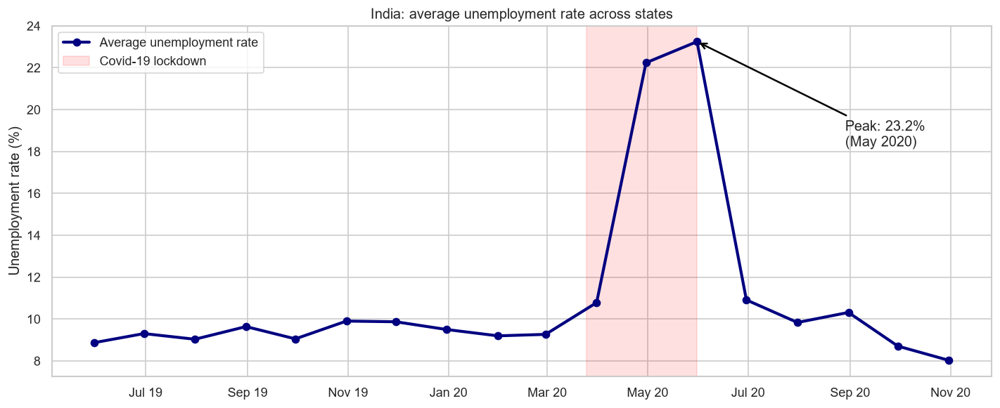
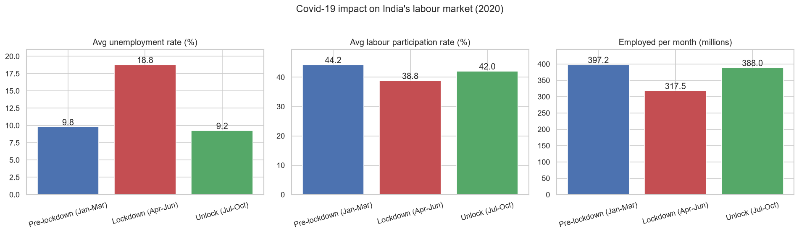
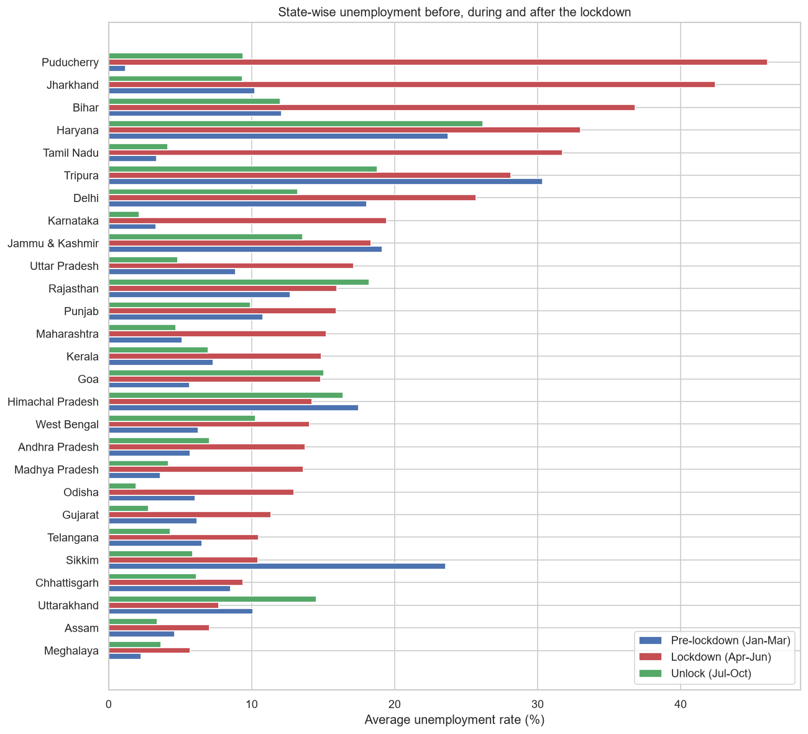
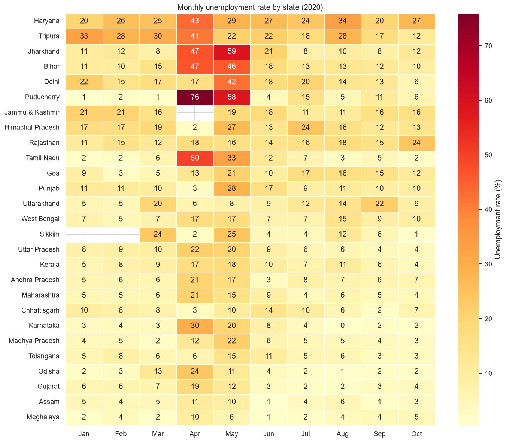
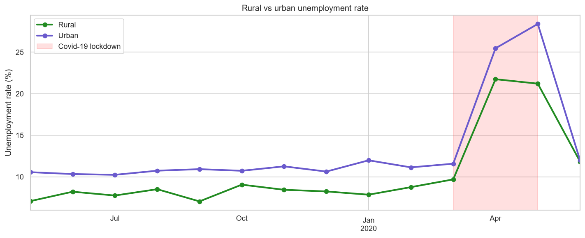

# CodeAlpha: Unemployment Analysis with Python

**Data Science Internship, Task 2 (CodeAlpha)**

An analysis of India's unemployment rate from May 2019 to October 2020. It covers data cleaning, exploration and visualisation, the **impact of Covid-19**, state, zone and rural/urban patterns, and seasonal trends, and ends with **insights for economic and social policy**.



## Key findings

| Phase (2020) | Avg unemployment rate | Labour participation | Employed per month* |
|---|---|---|---|
| Pre-lockdown (Jan–Mar) | 9.8% | 44.2% | 397 M |
| **Lockdown (Apr–Jun)** | **18.8%** | **38.8%** | **318 M** |
| Unlock (Jul–Oct) | 9.2% | 42.0% | 388 M |

<sub>*Across the 25 states that have data for every month.</sub>

1. **Covid-19 nearly doubled unemployment.** The rate peaked at **23.2% in May 2020**, compared with about 9–10% before the pandemic.
2. **About 114 million fewer people were employed** in April 2020 than in March. Labour participation also dropped, which means hidden unemployment was even larger than the headline rate shows.
3. **Hardest-hit states:** Puducherry (+44.9 points), Jharkhand (+32.2), Tamil Nadu (+28.4), Bihar (+24.7) and Karnataka (+16.1). The **East and South** zones spiked above 33%.
4. **Recovery was fast but uneven.** The national average was 8.0% by October 2020, but Goa, Puducherry, Rajasthan, Uttarakhand and West Bengal stayed above their pre-Covid levels.
5. **Some states have structural unemployment that predates Covid:** Tripura (29%), Haryana (23%), Himachal Pradesh (19%) and J&K (17%).
6. **Urban unemployment is higher than rural**, both before the lockdown (10.9% vs 8.2%) and during it (22.1% vs 18.3%).
7. **Seasonal pattern:** the rural rate swings more (7.0–9.1%) than the urban rate (10.2–12.0%), which fits the agricultural calendar.






## Policy suggestions
- Targeted relief for the hardest-hit states, sized to each state's lockdown spike
- An urban employment guarantee scheme, because cities were hit hardest
- Rural work programmes during lean agricultural months
- Long-term job creation (skills, MSMEs, local industry) in states with structurally high unemployment
- Track labour participation alongside unemployment to catch hidden job losses
- A monthly state-level early-warning dashboard for faster crisis response

## Project structure
```
CodeAlpha_UnemploymentAnalysis/
├── data/
│   ├── Unemployment in India.csv            # May 2019 – Jun 2020, rural/urban split
│   └── Unemployment_Rate_upto_11_2020.csv   # Jan – Oct 2020, with zones and coordinates
├── images/                                  # 12 charts generated by the code
├── unemployment_analysis.ipynb              # Notebook with code, outputs and explanations
├── unemployment_analysis.py                 # Same analysis as a plain Python script
└── requirements.txt
```

## Data cleaning steps
- Stripped extra spaces from column names and text values
- Removed 28 completely empty rows
- Renamed the duplicate `Region` column to `Zone`
- Fixed swapped `longitude`/`latitude` columns
- Converted the `DD-MM-YYYY` text dates to datetime

## How to run
```bash
pip install -r requirements.txt
python unemployment_analysis.py      # or: jupyter notebook unemployment_analysis.ipynb
```

## Dataset
[Unemployment in India on Kaggle](https://www.kaggle.com/datasets/gokulrajkmv/unemployment-in-india)

## Tech stack
Python · Pandas · NumPy · Matplotlib · Seaborn · Jupyter
